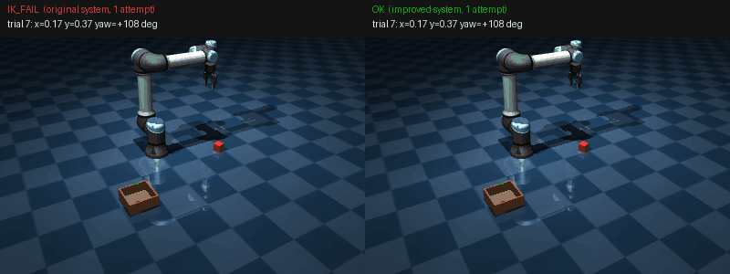
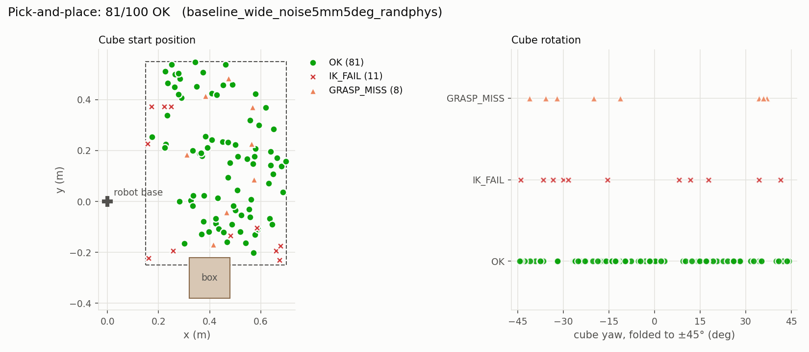
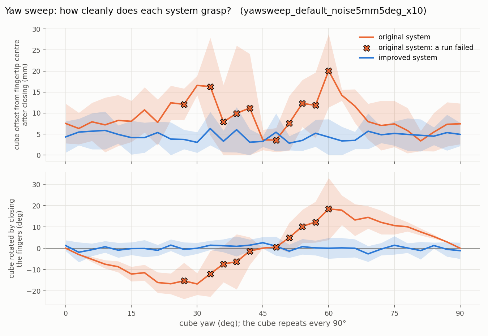
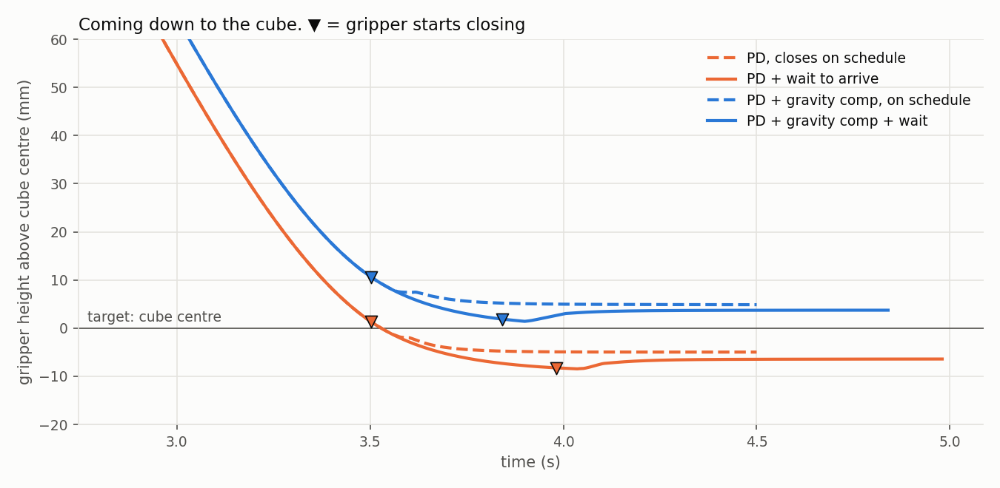
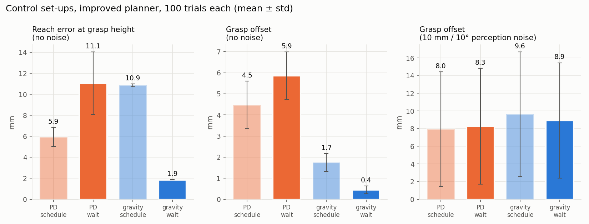
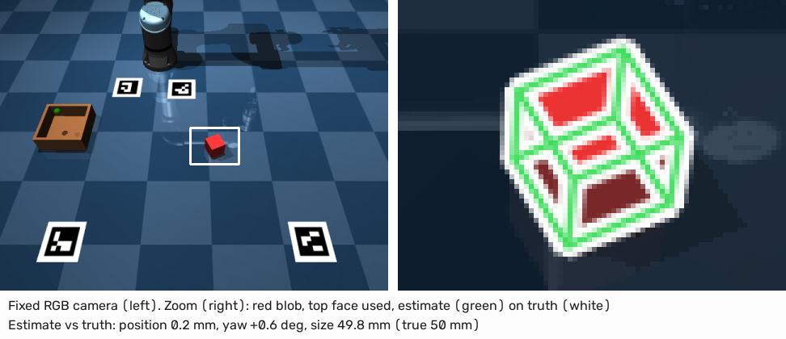
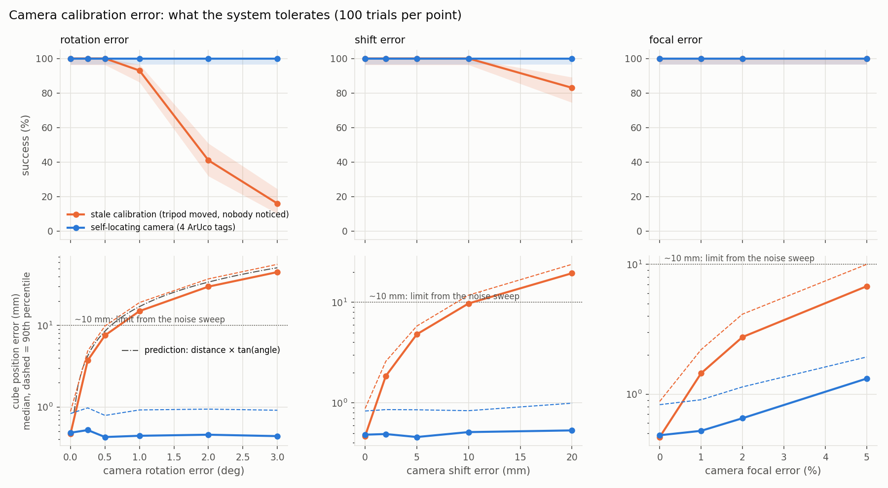
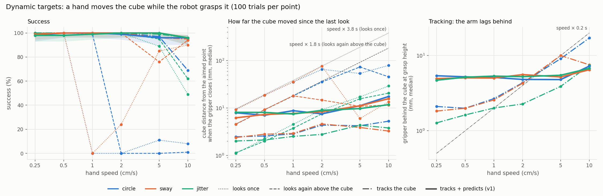
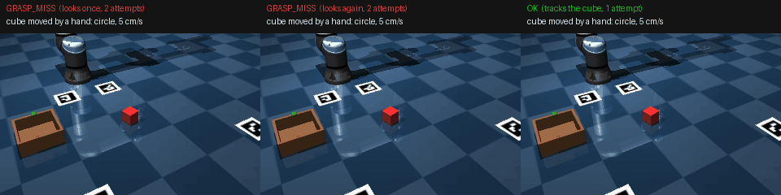
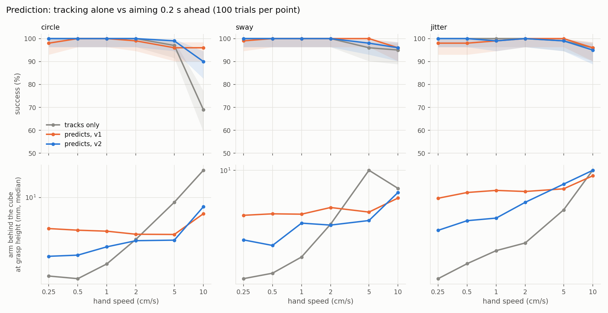

# Robust pick-and-place in MuJoCo, driven by evaluation

[](https://github.com/mahesaputranata/mujoco-manipulation/actions/workflows/tests.yml)

A 6-DOF UR5e arm with a Robotiq 2F-85 gripper picks a cube and places it in a box, in the
[MuJoCo](https://mujoco.org) physics simulator. The inverse kinematics is written from scratch.
The focus is **measuring** how robust the system is, then fixing what the measurements show.



*Same cube pose, two systems. Left: the original planner's IK gets stuck in a local minimum.
Right: the improved system restarts IK, checks for collisions and completes the task.*

**Results**

- **80% → 99.8% success (400 → 499 of 500 held-out trials)** in the hardest setting: wide
  workspace, 5 mm / 5° perception noise, random cube size, mass and friction.
- **Grasp precision 4.5 mm → 0.4 mm** without noise, from gravity compensation plus waiting for
  the arm to arrive before closing the gripper.
- Breaking point found: the system holds 99–100% up to 10 mm / 10° of perception error and
  degrades beyond that. Under noise, perception error dominates; the controller barely matters.
- **The arm finds the cube with its own camera**: a fixed RGB camera replaces the simulator's
  exact cube pose. Perception error 0.6 ± 0.4 mm and 0.0 ± 0.5°; 500/500 held-out trials succeed.
- **It catches a moving cube**: tracking with a Kalman prediction keeps ≥ 95% success with a hand
  moving the cube at up to 10 cm/s (the fastest tested). Looking once, it managed only 0.5 cm/s.
- Continuous grasp measurements predicted *where* the original system would fail before any
  run actually failed.

## How the system works

```
RGB camera ──► perception ──► planner ──► IK ──► smooth trajectory ──► PD + gravity comp ──► MuJoCo physics
 (fixed)      cube pose        waypoints   damped        (smoothstep)       (Menagerie servos)
              (or: oracle)                 least squares
                                  ▲                                                          │
                                  └───────────── checks after each segment ◄─────────────────┘
                            (has the arm arrived? did the cube lift? still in hand?)
```

| Component | What it does |
|---|---|
| [`perception.py`](perception.py) | Fixed RGB camera → red-cube mask → top face → rays to the table → cube position, yaw and size |
| [`ik.py`](ik.py) | Damped least-squares IK from scratch; multi-start with collision rejection |
| [`demo_reach.py`](demo_reach.py) | Planner: grasp selection, IK waypoints, wait-to-arrive, segment checks, one re-grasp |
| [`controllers.py`](controllers.py) | Joint PD (Menagerie servo) and PD + gravity compensation |
| [`eval_place.py`](eval_place.py) | Randomized evaluation: success rate with 95% CI, failure types, margins, sweeps |
| [`render_trials.py`](render_trials.py) | Replays any trial from its seed as a GIF (also side by side) |
| [`hand_motion.py`](hand_motion.py), [`dynamic_sweep.py`](dynamic_sweep.py) | Dynamic targets: a hand moves the cube; success vs hand speed |
| [`predict.py`](predict.py) | Constant-velocity Kalman filter: where the moving cube will be |
| [`visibility_map.py`](visibility_map.py) | Segmentation renders: how much of the cube the camera sees, and what hides it |
| [`calib_sweep.py`](calib_sweep.py) | Camera calibration experiment: knocked camera, stale belief vs self-locating from ArUco tags |
| [`plot_controllers.py`](plot_controllers.py), [`plot_perception.py`](plot_perception.py) | Controller and perception figures |
| [`scene.py`](scene.py) | Builds the scene with `MjSpec`: UR5e + 2F-85 from MuJoCo Menagerie, cube, box |
| [`tests/`](tests) | Unit, integration and regression tests (pytest), run by CI on every push |
| [`fundamentals/`](fundamentals) | DH-parameter visualizers; FK/Jacobian/IK derivation drill in PyTorch |

The **original system** is the first working version: fixed grasp orientation, single-start IK,
plain PD control, and the gripper closing on a fixed schedule. The **improved system** has
every fix below.

## Evaluation

Each trial samples a cube position and a yaw over the full 360°. Optional variations:
perception noise (Gaussian error on the pose the planner sees), random cube physics (edge
3.6–6 cm, mass 50–300 g, friction 0.4–1.2) and a wider workspace. Each trial is deterministic
and reproducible from its seed. It is classified as `OK`, `IK_FAIL`, `GRASP_MISS`, `DROPPED` or
`MISSED_BOX`, and logs grasp offset, grasp twist, placement error and tracking errors.

| Setting (100 trials) | Original | Improved |
|---|---|---|
| Default workspace | 100% | 100% |
| + 5 mm / 5° perception noise | 94% | 100% |
| + random cube physics | 100% | 100% |
| Wide workspace | 92% | 100% |
| Wide + noise + physics | 81% | 100% |
| **Held out: wide + noise + physics, 500 trials, new seed** | **80%** (CI 76–83%) | **99.8%** (CI 99–100%) |

The one held-out failure (trial 225) is a large cube next to the robot base: with 6–7 mm of
perception error, a finger lands on top of the cube instead of beside it.



*Original system, hardest setting. IK failures sit at the edges of the workspace. Most grasp
misses happen where the cube is rotated about 30–45° (right panel).*

### Breaking point: perception noise

| Noise (mm / deg) | 0 | 5 | 10 | 15 | 20 | 25 |
|---|---|---|---|---|---|---|
| Original | 100% | 94% | 71% | 53% | 38% | 25% |
| Improved | 100% | 100% | 99% | 82% | 65% | 49% |

At 15 mm / 15°, each of 100 poses was run with 10 noise samples: 858/1000 OK (95% CI 83–88%).
**No pose always failed, and 80 of 100 were fragile**, so failures come from perception error,
not from where the cube is. The re-grasp step rescued 229 of 371 missed grasps.

### Margin, not just pass/fail: yaw sweep

The cube stays at one spot while its yaw steps through one 90° period. Without noise, both
systems pass every yaw. Between about 15° and 75°, though, the original system shoves the cube
up to 19 mm and twists it up to 27° while closing; the gripper drags it square. Once noise is
added, its failures land exactly in that band.



| Yaw sweep | Original | Improved |
|---|---|---|
| Grasp offset, no noise | 8.5 ± 4.7 mm (max 19.4) | 0.4 ± 0.1 mm (max 0.9) |
| Grasp twist, no noise | ± 13.4° (max 27.5°) | ± 0.0° |
| Success, 5 mm / 5° noise, 10 samples per yaw | 293/310 | 310/310 |

## Control: gravity compensation and waiting to arrive

The joints start as MuJoCo position servos, which act as PD controllers:
`τ = kp·(q_target − q) − kd·q̇`. A PD controller only pushes when there is an error, so to hold
the arm up it **must sag** until `kp·error` equals the gravity torque: 11 mm at the gripper.

**Gravity compensation** adds the model's gravity torque `g(q)` (from recursive Newton–Euler) as
feedforward, sent through the servo as `ctrl = q_target + g(q)/kp`. This keeps the servo's
implicitly integrated damping and its torque limits. Computing the damping explicitly in Python
would put the wrist at the edge of numerical stability (kd·dt/I = 1.99, limit 2).

| Improved planner, 100 trials | PD, closes on schedule | PD + wait | Gravity comp, on schedule | **Gravity comp + wait** |
|---|---|---|---|---|
| Sag when holding still | 11.2 mm | 11.2 mm | 0.1 mm | **0.1 mm** |
| Reach error at grasp height | 5.9 mm | 11.1 mm | 10.9 mm | **1.9 mm** |
| Grasp offset (no noise) | 4.5 ± 1.1 mm | 5.9 ± 1.1 mm | 1.7 ± 0.4 mm | **0.4 ± 0.2 mm** |
| Placement error (no noise) | 5.0 ± 2.1 mm | 5.5 ± 2.5 mm | 1.8 ± 0.6 mm | **0.6 ± 0.3 mm** |
| Grasp offset (10 mm / 10° noise) | 8.0 ± 6.5 mm | 8.3 ± 6.6 mm | 9.6 ± 7.1 mm | 8.9 ± 6.5 mm |
| Success (10 mm / 10° noise) | 100% | 100% | 98% | 99% |
| Extra time per pick-and-place | — | 0.9 s | — | 0.6 s |



What the measurements showed:

1. **Two errors were cancelling.** Coming down, the PD lags behind the trajectory (gripper too
   high) while gravity pulls it down (too low). With plain PD they happened to cancel. Removing
   the sag exposed the lag: the gripper closed 11 mm above the cube's centre (dashed blue line).
2. **The planner closed the gripper on a fixed schedule**, assuming the arm keeps up. Fix:
   before closing or releasing, hold the target until the gripper is within 2 mm, has stopped
   moving, or 1.5 s have passed. Waiting needs gravity compensation: with plain PD it only
   lets the sag fully develop (solid orange line).
3. **Under perception noise the controller barely matters.** A 0.4 mm-precise arm aimed at the
   wrong spot still misses by the perception error. The next gain is in perception or in
   closing the loop visually, not in control.



## Perception: the arm finds the cube itself

Until now the planner was told the cube's exact pose by the simulator (an "oracle"). Now a fixed
RGB camera, like a webcam on a stand at a desk, sees the scene, and `perception.py` estimates the
cube's pose from the image alone: `eval_place.py --perception camera`.



**The geometry is the hard part, not the detector.** A colour threshold finds the red cube. But a
camera looking down at 45° also sees the cube's sides, so the centre of the red blob is not the
centre of the cube: projected onto the table it is about 2 cm off. Instead:

1. Find the **top face**, the brightest part of the blob (it is lit from above; Otsu's threshold).
2. Cast rays from the camera through the outline of the top face and intersect them with the
   plane of the cube's top.
3. Fit a rectangle: centre → position, angle → yaw, width → size.
4. The cube's height is not known in advance (random sizes), but a cube is as tall as it is
   wide, so: assume a height, measure the width, use it as the new height, and repeat. It converges
   in a few steps and estimates the size to within about 1 mm.

| 100 trials (500 held out) | Oracle (exact pose) | Camera | Camera perception error |
|---|---|---|---|
| Default workspace | 100%, grasp 0.4 ± 0.2 mm | 100%, grasp 0.7 ± 0.4 mm | 0.5 ± 0.3 mm, 0.0 ± 0.4° |
| + random cube physics | 100%, grasp 0.6 ± 0.2 mm | 100%, grasp 0.8 ± 0.4 mm | 0.4 ± 0.3 mm, 0.1 ± 0.4° |
| Wide workspace | 100%, grasp 0.3 ± 0.2 mm | 100%, grasp 0.7 ± 0.4 mm | 0.5 ± 0.3 mm, 0.0 ± 0.4° |
| **Held out: wide + physics, 500 trials** | | **500/500**, grasp 0.8 ± 0.5 mm | 0.6 ± 0.4 mm (max 1.8), 0.0 ± 0.5° |

What the measurements taught:

- **The edge of a mask is not where you think.** The outline was first pushed out by half a pixel
  (right for hard-edged pixels). Measured on 40 rendered cubes, MuJoCo's anti-aliasing makes 0.25
  pixel correct: the size bias went from +0.6 to +0.1 mm and the position error halved (1.3 → 0.6 mm).
- **Frames cannot be trusted blindly.** Under parallel load, this laptop's OpenGL once returned a
  wrong image (an estimate 77 cm from the cube) and, separately, aborted a worker process. The
  camera now looks twice and accepts only plausible, consistent estimates (rejected frames are
  counted), and the evaluation re-runs trials whose worker crashed instead of hanging.

The simulated camera is close to ideal: perfect lighting, no lens distortion or sensor noise. The
next section drops the last idealization, an exactly known camera pose.

## Camera calibration: what happens when the tripod moves

The camera-to-table geometry above needs the camera's exact pose (position and angle) and focal
length. On a real desk these come from a calibration that is never perfect, and a tripod gets
knocked. `calib_sweep.py` moves the *real* camera (rotation about a random axis, a shift in a random
direction, a wrongly believed focal length), one factor at a time, 100 trials per point, and compares
what perception believes:

- **stale:** the camera pose from before the knock (nobody noticed the tripod moved);
- **marker:** the camera locates itself in every image from four printed **ArUco tags** at known
  spots on the table (two near the robot base, two beyond the far edge of the workspace), with
  OpenCV's `solvePnP`.



| Camera error that still keeps success ≥ 95% | Stale calibration | Self-locating (4 tags) |
|---|---|---|
| Rotation | **0.5°** (93% at 1°, 41% at 2°, 16% at 3°) | **≥ 3°** (100% everywhere tested) |
| Shift | **10 mm** (83% at 20 mm) | **≥ 20 mm** |
| Focal length | ≥ 5% (cube error 6.8 mm) | ≥ 5% (cube error 1.3 mm) |
| A realistic knock: 1°, 5 mm, 2% at once | 93%, cube error 14 mm | **100%, cube error 0.7 mm** |

What the measurements showed:

- **Angle errors dominate.** With a stale calibration the cube error grows by about 15 mm per
  degree, exactly the prediction *camera distance × tan(angle)* (the dash-dot line). Since the
  system tolerates ~10 mm, a tripod knocked by **half a degree** is already at the limit. Shifts
  matter 1:1 (10 mm of camera shift → 10 mm of cube error), so they are much more forgiving.
- **One tag is not enough.** A single 8 cm tag located the camera so poorly (47 mm, 1.3°) that the
  cube error was 19 mm, worse than a 1° knock. Four tags spread across the table brought it to
  0.6 mm, as good as knowing the true camera: corners far apart pin the camera's angle down.
- **The camera's view needs a margin.** At first the far tags sat on the bottom edge of the image,
  and a 1° knock pushed them out of view, exactly when they were needed. The camera was re-aimed
  so all tags stay in view after a 3° knock.
- **The tags even absorb a wrong focal length** (a prediction that turned out wrong: I expected the
  marker method could not fix lens errors). With the focal length 5% off, the located camera is
  4 cm away from the truth, but rays to the table still land in the right places, because the
  cube lies almost in the tags' plane. The error comes back only with height: 1.3 mm at 5%.

For a real desk: tape four printed tags around the workspace, and the robot can re-locate its camera
from every image, so a knocked tripod stops being a silent failure.

## Dynamic targets: a cube that moves

A "hand" holds the cube and moves it while the robot tries to grasp it (`hand_motion.py`): a mocap
body the script moves every physics step, welded to the cube until the gripper has closed around it
(a handover). Three motions (a 4 cm circle, a ±5 cm sway, hand-like jitter) at 0.25–10 cm/s, 100
trials each, with camera perception: `dynamic_sweep.py`.



*Middle panel: with prediction the gripper deliberately aims where the cube will be 0.2 s later,
not where it is, so its distance from the cube at closing is larger than with tracking alone (and
the arm's lag, right, smaller).*

| Hand speed (cm/s) | 0.25 | 0.5 | 1 | 2 | 5 | 10 |
|---|---|---|---|---|---|---|
| circle, looks once | 100% | 100% | 0% | 0% | 11% | 8% |
| circle, looks again | 100% | 100% | 99% | 0% | 0% | 1% |
| circle, tracks | 100% | 100% | 100% | 100% | 97% | 69% |
| circle, **tracks + predicts** | 98% | 100% | 100% | 99% | **96%** | **96%** |
| sway, looks once | 100% | 100% | 0% | 24% | 85% | 90% |
| sway, looks again | 100% | 100% | 100% | 100% | 76% | 94% |
| sway, tracks | 100% | 100% | 100% | 100% | 96% | 95% |
| sway, **tracks + predicts** | 99% | 100% | 100% | 100% | **100%** | **96%** |
| jitter, looks once | 100% | 100% | 100% | 100% | 89% | 49% |
| jitter, looks again | 100% | 100% | 100% | 100% | 95% | 62% |
| jitter, tracks | 100% | 100% | 100% | 100% | 99% | 96% |
| jitter, **tracks + predicts** | 98% | 98% | 99% | 100% | **100%** | **96%** |

Fastest speed with ≥ 95% success (all slower speeds too): looks once 0.5–2 cm/s, looks again
1–5, tracks 5–10, **tracks + predicts 10 cm/s for all three motions** (the fastest tested).

What the measurements showed:

- **The planner looks once, then moves blindly, and the look is 3.8 s old when the gripper
  closes** (2 s to above the cube, 1.5 s down, then the wait to arrive). In that time the cube
  travels speed × 3.8 s: the dash-dot line, which the measurements follow exactly at low speed.
- **The gripper catches the cube up to about 19 mm from where it aimed and misses beyond ~35 mm.**
  So a steadily moving cube is tolerated only up to **0.5 cm/s**, a speed no hand holds still at.
- **Success at high speed is luck, not skill.** The sway at 5–10 cm/s succeeds 85–90% because its
  back-and-forth period (2–4 s) happens to bring the cube back near its start just as the gripper
  closes. Pass/fail alone would have called the system *better* at 10 cm/s than at 1 cm/s; the
  measured cube travel shows why it isn't.
- Jitter stays within a few cm of its start, so it is tolerated up to 2 cm/s.

**Look again (Option A).** Once the gripper is above the cube, the planner takes a second look and
re-plans the descent from it (`--look-again`). The second look saw the cube in every trial: the
gripper above it does not block the camera's angled view. The look is now 1.8 s old when the gripper
closes instead of 3.8 s, so the tolerated speed doubles: circle 0.5 → 1 cm/s, sway 0.5 → 2 cm/s,
jitter 2 → 5 cm/s (success ≥ 95%). Still far below a real hand.



*The same trial, a cube circling at 5 cm/s (the hand moving it is invisible). Looking once or
twice, the gripper closes where the cube was and misses twice; tracking follows it and grasps it
on the first attempt.*

**Track (Option B).** The camera keeps watching every frame (20 Hz) of the descent and the grasp,
and the gripper's aim follows the cube (visual servoing, `--track`). Two problems had to be solved
first, both found by logging what the camera saw frame by frame:

- **The gripper's own shadow.** The light shines straight down, so from ~10 cm above the cube the
  gripper's shadow darkens its top face, and "brightest part = top face" fails: estimates were
  41–47 mm off. Tracking frames therefore fit a cube of the size measured in the first look to the
  **whole red silhouette** (`perception.fit_silhouette`): shadowed or partly covered, within ~1 mm.
- **Partly hidden cubes.** Fits are only trusted if at least 40% of the cube is visible. Measured
  on 296 tracking frames: under 30% visible was 43 mm off (median), 40–50% was 2.2 mm. (This
  threshold depends on lighting: under CI's software renderer the shadowed cube is darker, so
  fewer of its pixels pass the red test. A real camera will need it re-measured.)
- **Losing the cube, though the camera could see it.** Trials that lost 40+ frames failed 59% of
  the time, so I first assumed the arm blocked the camera's view. A segmentation render on every
  frame (`visibility_map.py`: 100 still-cube positions and rotations) showed it never does: the
  cube stays at least 40% visible at every gripper height, and only at the grasp do the fingers
  cover ~17% of it. The real cause was a **tracking-loss cascade**: the silhouette fit only searches
  near its start, one bad frame left the start 4–9 cm off, and every later frame started further
  away (23–56 frames lost in a row, with the cube 43–83% visible). Each fit now also starts from the
  red blob's centre and keeps the better match, so tracking recovers after a bad frame.

With tracking the aim stays within ~4–5 mm of the cube even at 10 cm/s: perception keeps up. What
remains is the **arm lagging behind the moving cube by about speed × 0.2 s** (right panel): ~9–10 mm
at 5 cm/s and 17 mm at 10 cm/s on the circle, with a long tail (90th percentile 49 mm at 10 cm/s).
That lag is the controller's, which motion prediction and a faster controller (computed torque)
address.

**Predict (Option C1).** A constant-velocity Kalman filter (`predict.py`) remembers how the cube has
been moving, and the gripper aims where the cube will be 0.2 s ahead (the lag measured above; fixed
in advance and checked on separate validation trials, seed 1, not tuned on the reported ones).



| 18 moving settings × 100 trials | Tracks only | **Predicts, v1** | Predicts, v2 |
|---|---|---|---|
| Total successes (of 1800) | 1752 | **1775** | **1776** |
| Fastest speed ≥ 95%: circle / sway / jitter (cm/s) | 5 / 10 / 10 | **10 / 10 / 10** | 5 / 10 / 10 |
| Circle at 10 cm/s | 69% | **96%** | 90% |
| Slow speeds (0.25–2 cm/s) | 100% | 98–100% | **100%** |
| Median arm lag, still cube | 1.6 mm | 4.6 mm | 3.2 mm |

- **v1** (the filter as first designed) aims ahead whenever it estimates any velocity. It reaches
  ≥ 95% success at every speed tested, up to 10 cm/s on all three motions. Its cost is a small lag
  floor (~5 mm even for a still cube): the filter reads the estimate's wobble as velocity and the
  0.2 s lead amplifies it. A first version had assumed 1.5 mm of camera noise instead of measuring
  it, and prediction looked useless until it was measured.
- **v2** sets the filter's trust in each frame from measurements on moving cubes (0.7 mm wobble
  with the gripper above 60 mm, 1.4 mm below, plus drift near the grasp), and only aims ahead once
  the cube clearly moves (no lead below 1 cm/s, full lead above 2 cm/s). It is perfect at slow
  speeds but more cautious on the fast circle (90%). Overall the two tie (1775 vs 1776).
- **What the earlier sweep got wrong.** Before the tracking-loss fix, v2 looked like the clear
  winner (1735 vs 1703) and v1 seemed to fail fast jitter (84%). Both effects were mostly the
  cascade: v2's refinements had been compensating for it. With the root cause fixed, the simpler
  v1 is at least as good, and tracking alone improved too (1709 → 1752).

## What failed, and the fixes

Each fix came from replaying a specific failed trial, not from guessing.

1. **Fingers closing on the cube's corners.** This was hidden without noise, because the gripper
   twists the cube square as it closes. **Fix:** turn the gripper to match the cube's yaw. A cube
   repeats every 90°, so the wrist never turns more than 45°.
2. **IK stuck in local minima** on reachable targets. Damped least squares wound the base joint
   the long way round into its ±360° limit. **Fix:** multi-start IK that keeps the converged
   solution closest to the current pose.
3. **IK solutions through the table.** A restart once put the forearm inside the floor.
   **Fix:** reject poses where the arm touches the floor or box, and allow restarts only for big
   moves at a safe height. Otherwise, interpolating in joint space sweeps the arm through the scene.
4. **Cube next to the box wall.** One finger would have entered the wall. **Fix:** fall back to
   the other grasp, with the fingers on the other pair of faces.
5. **Open-loop grasping.** **Fix:** check that the cube actually lifted; on a miss, back off,
   look again and re-plan once.
6. **Gravity sag and closing before the arm arrives** (see Control). **Fix:** gravity
   compensation, and wait for the arm to arrive before closing or releasing.

## Testing

Two layers, for two different questions:

- **Is each part correct?** A pytest suite (282 tests, ~1–2 min) runs on every push via GitHub Actions:
  - *unit:* IK round trips (FK → IK → same pose), behaviour on unreachable targets, collision
    detection, grasp angles square to the cube's faces, Wilson confidence intervals, trial sampling;
  - *integration:* a full pick-and-place with every controller in `CONTROLLERS` (new controllers
    are tested automatically), and a precision check for the final set-up;
  - *regression:* previously fixed failures stay fixed (trial 7: IK local minimum; trial 85: box
    wall), a success floor in the hardest setting, and seed reproducibility;
  - *perception:* camera projection round trips, cube pose recovered from synthetic images with a
    known answer, rendered-image accuracy, rejection of bad frames, an end-to-end run with the
    camera, and the calibration experiment (the camera is knocked by exactly the requested amount,
    every method gets the same knock, the tags locate the camera, stale misses after a 2° knock);
  - *prediction:* the Kalman filter learns a constant velocity exactly, keeps predicting without
    frames, and beats the current estimate on a circling cube; prediction cuts the lag on a swaying
    cube (judged on the median of 4 trials: a single-trial version passed on the laptop's GPU and
    failed under CI's software renderer);
  - *dynamic targets:* hand speeds, the weld carrying the cube, the handover, and a baseline test
    that documents the look-once limit (a cube moving 1 cm/s is missed) next to the look-again
    planner that catches it; tracking catches a 2 cm/s circle that both miss; the silhouette fit
    survives a shadowed, partly covered top face; the three trials that used to cascade (1, 2, 8
    at 10 cm/s) now succeed, checked under both renderers. CI renders with OSMesa (software OpenGL), and these tests must run there, not skip.
- **How well does the whole system work?** `eval_place.py`: scenario-based statistical evaluation
  (the results above).

The tests were checked by injecting bugs on purpose. Flipping the sign of gravity compensation, or
making the grasp ignore the cube's yaw, must make tests fail. The second one first went
unnoticed, which exposed a gap: an unaligned but well-centred gripper can hold a cube rotated by
30–40° by its corners without twisting it, so the twist check now also runs at 10° and 20°.

```bash
.venv/bin/pip install -r requirements-dev.txt
.venv/bin/python -m pytest -q                # all tests
.venv/bin/python -m pytest -q -m "not slow"  # skip the longer success-floor run
```

## Limitations

This is still an idealized setup, and the limits are stated here on purpose:

- **Control:** joint PD with gravity compensation, but no feedforward for the planned motion, so
  the arm still lags up to ~30 mm during fast moves (waiting hides this at the grasp, at a cost of
  0.6 s). The grasped cube's weight is not compensated. There is no motor model, latency, backlash
  or sensor noise.
- **Perception:** a simulated, near-ideal camera; colour-based detection of one red cube. The pose
  is estimated once per attempt, not tracked during the motion.
- **Objects:** one rigid cube, always flat (only the yaw varies). A moving cube stays on the table:
  perception assumes the table plane, so a cube held up in the air needs depth sensing.
- **No sim-to-real gap:** the simulated robot is the "real" robot.

## Reproduce

```bash
git clone https://github.com/mahesaputranata/mujoco-manipulation && cd mujoco-manipulation
git clone https://github.com/google-deepmind/mujoco_menagerie third_party/menagerie
python3 -m venv .venv && .venv/bin/pip install -r requirements.txt

.venv/bin/python demo_reach.py                                    # watch one pick-and-place in 3D
.venv/bin/python eval_place.py                                    # improved system, 100 trials
.venv/bin/python eval_place.py --baseline                         # original system
.venv/bin/python eval_place.py --workspace wide --pos-noise 5 --yaw-noise 5 --rand-physics
.venv/bin/python eval_place.py --perception camera               # the arm finds the cube with its camera
.venv/bin/python calib_sweep.py                                   # camera calibration experiment (~20 min, resumable)
.venv/bin/python dynamic_sweep.py                                 # moving cube, 5 planner variants (~3 h, resumable)
.venv/bin/python eval_place.py --controller pd --no-arrive        # improved planner, original control
.venv/bin/python eval_place.py --yaw-sweep --pos-noise 5 --yaw-noise 5 --repeats 10 --sweep-step 3
.venv/bin/python eval_place.py --baseline --workspace wide --replay 7   # replay one trial in 3D
.venv/bin/python render_trials.py --workspace wide --trial 7 --compare  # ... or as a GIF
.venv/bin/python render_trials.py --perception camera --motion circle --speed 5 --trial 0 \
    --planners once,again,track --closeup                         # the moving-cube GIF above
.venv/bin/python plot_controllers.py                              # controller figures (needs the runs above)
```

100 trials take about 20 s on 8 CPU cores. Results go to `results/<tag>/`: `trials.csv` (one row per
trial, with its seed) and `run_info.json` (the exact settings, git commit and library versions), so
every baseline stays traceable and every trial reproducible.

## Roadmap

The end goal is a real 6-DOF arm on a Jetson that folds cloth from a voice command, using a
vision-language-action (VLA) policy.

- [x] Scene, damped least-squares IK from scratch, pick-and-place
- [x] Randomized evaluation and robustness fixes
- [x] Gravity compensation and wait-to-arrive; controller comparison
- [x] Camera perception: fixed RGB camera, cube pose from the image
- [x] Camera calibration experiment; self-locating camera from ArUco tags
- [x] Dynamic targets: baseline, a second look above the cube, tracking with a shadow-robust
      silhouette fit, motion prediction with a Kalman filter (this page)
- [ ] Computed-torque control (removes the motion lag), then operational-space / impedance
      control for contact-rich tasks (in progress)

## Acknowledgements

The robot models come from [MuJoCo Menagerie](https://github.com/google-deepmind/mujoco_menagerie)
(UR5e, Robotiq 2F-85), under their respective licenses. They are not included in this repo.
The code here is under the [MIT License](LICENSE).
